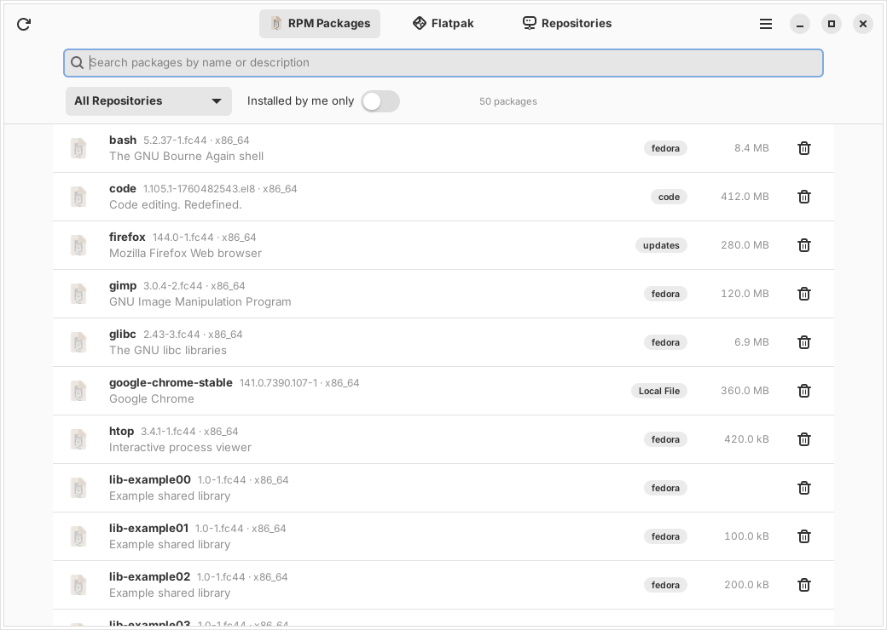
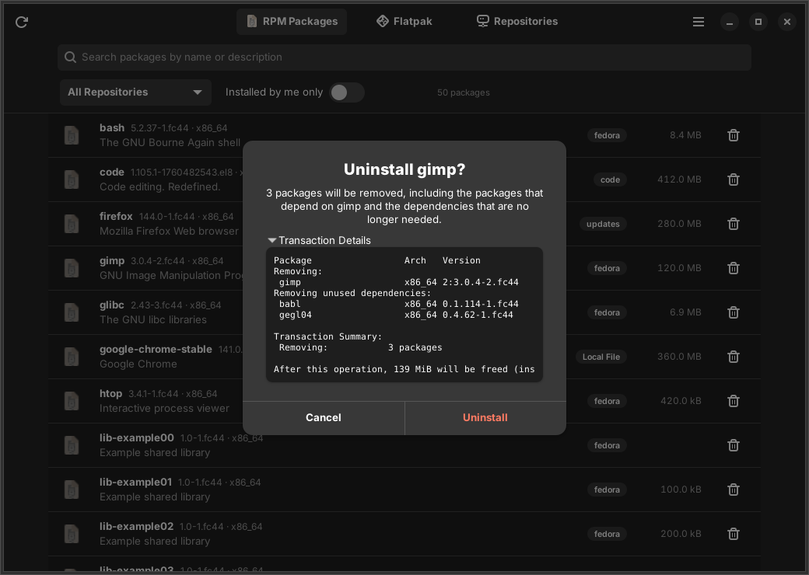
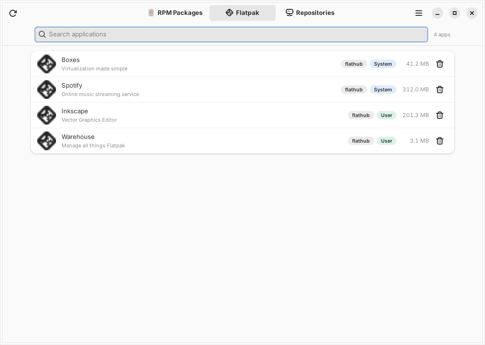
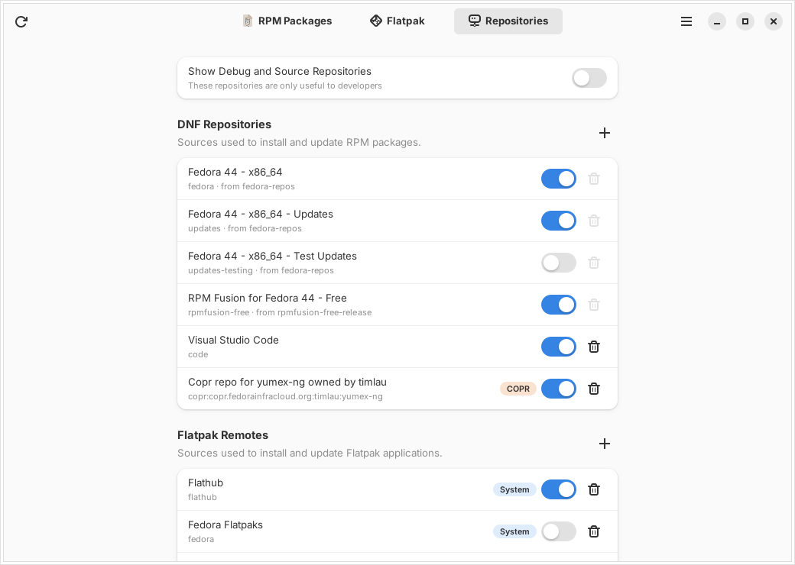
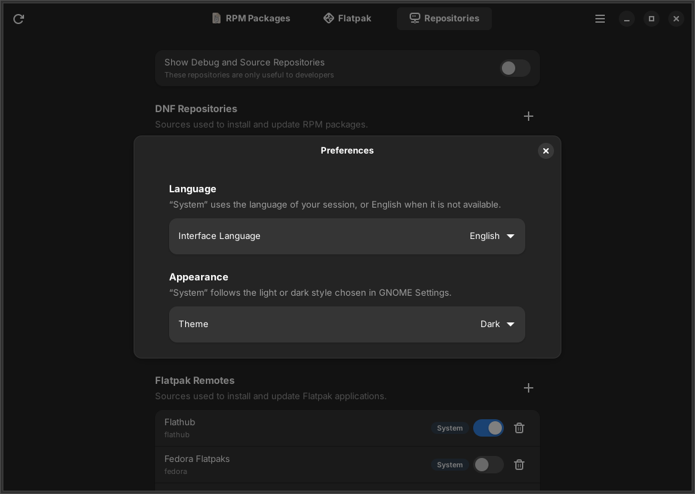

<div align="center">


# Uninstall Plus

**See everything installed on your Fedora system — and remove it.**

A GNOME app that lists all your RPM packages and Flatpak applications,
including software installed from the command line, which GNOME Software does not show.

[](https://github.com/3zmana/uninstall-plus/releases/latest)
[](LICENSE)




</div>

## Features

### RPM Packages
- Every installed package with its version, description, size and **origin repository**
- Search by name or description, filter by repository
- **"Installed by me only"** switch to hide packages pulled in as dependencies
- Details for each package: license, website, vendor, install date, full description
- Safe uninstall: DNF first computes the transaction, you see **exactly what will be
  removed** (dependent packages and unused dependencies included), then confirm

### Flatpak
- Every installed application, system-wide and per-user
- Uninstall with an option to also delete the app's data
- Runtimes that are no longer used are cleaned up automatically

### Repositories
- **DNF**: enable, disable and remove repositories; add one from a `.repo` URL,
  a **COPR** project (`owner/project`) or a manual entry
- **Flatpak remotes**: enable, disable, remove and add (Flathub is pre-filled)
- Repositories that belong to the system (for example `fedora` and `updates`)
  can be disabled but not removed, so you cannot break your system by accident

### Preferences
- Interface language: **System** (default), English or French —
  "System" uses your session language when it is translated, English otherwise
- Theme: **System** (default), Light or Dark

## Screenshots

| Uninstall confirmation | Flatpak |
|---|---|
|  |  |
| **Repositories** | **Preferences** |
|  |  |

## Installation

Download the RPM from the [latest release](https://github.com/3zmana/uninstall-plus/releases/latest),
then install it:

```bash
sudo dnf install ./uninstall-plus-1.0.1-2.fc44.noarch.rpm
```

Uninstall Plus then appears in your applications menu.

**Requirements:** Fedora 44 (GNOME 50) or later, with Python 3, PyGObject, GTK 4,
libadwaita ≥ 1.5, dnf5 and dnf5-plugins, Flatpak and polkit. DNF installs
anything missing automatically.

## Building from source

```bash
sudo dnf install rpm-build make gettext desktop-file-utils libappstream-glib
git clone https://github.com/3zmana/uninstall-plus.git
cd uninstall-plus
make rpm
sudo dnf install ./rpmbuild/RPMS/noarch/uninstall-plus-*.noarch.rpm
```

To run it straight from the source tree, without installing:

```bash
make locale
UNINSTALL_PLUS_DATADIR=$PWD UNINSTALL_PLUS_LOCALEDIR=$PWD/build/locale \
UNINSTALL_PLUS_HELPER=$PWD/helper/uninstall-plus-helper python3 bin/uninstall-plus
```

Run the tests with `make test`.

## How it works

- **Reading needs no privileges.** Packages come from `rpm -qa`, their origin
  repository and install reason from `dnf repoquery`, Flatpak data from
  `flatpak list` and `flatpak remotes`, and `.repo` files are parsed directly.
- **Changes go through a small privileged helper**
  (`/usr/libexec/uninstall-plus/uninstall-plus-helper`) started with `pkexec`.
  It only accepts a fixed list of actions, checks every argument against
  strict patterns and never uses a shell. The polkit policy keeps your
  authorization for a few minutes, so previewing and then removing a package
  asks for your password only once.
- **Flatpak** asks for authentication by itself when needed.
- Settings are stored in `~/.config/uninstall-plus/settings.json`.

```
uninstall_plus/   the application (GTK 4 + libadwaita, Python)
helper/           the privileged helper run through pkexec
data/             desktop file, AppStream metadata, icons, polkit policy
po/               translations (gettext)
tests/            unit tests
```

## Translations

Translations use gettext and live in `po/`. To add a language:

1. Add its code to `po/LINGUAS`
2. Create `po/<code>.po` from `po/uninstall-plus.pot` (for example with `msginit`)
3. Add the language to `SUPPORTED_LANGUAGES` in `uninstall_plus/i18n.py`

After changing strings in the code, run `make pot` to update the template.

## Made with vibe coding

This project was **vibe coded**: it was built through a conversation with
[Claude](https://claude.ai) (Anthropic), an AI assistant, which wrote the code,
the translations and this README from my descriptions and feedback. I described
what I wanted, tested, and asked for changes.

The code has unit tests and was checked carefully, but it was not written line by
line by a human. Read it before trusting it with your system, and please
[open an issue](https://github.com/3zmana/uninstall-plus/issues) if you find a bug.

## License

[MIT](LICENSE) © 2026 3zmana
